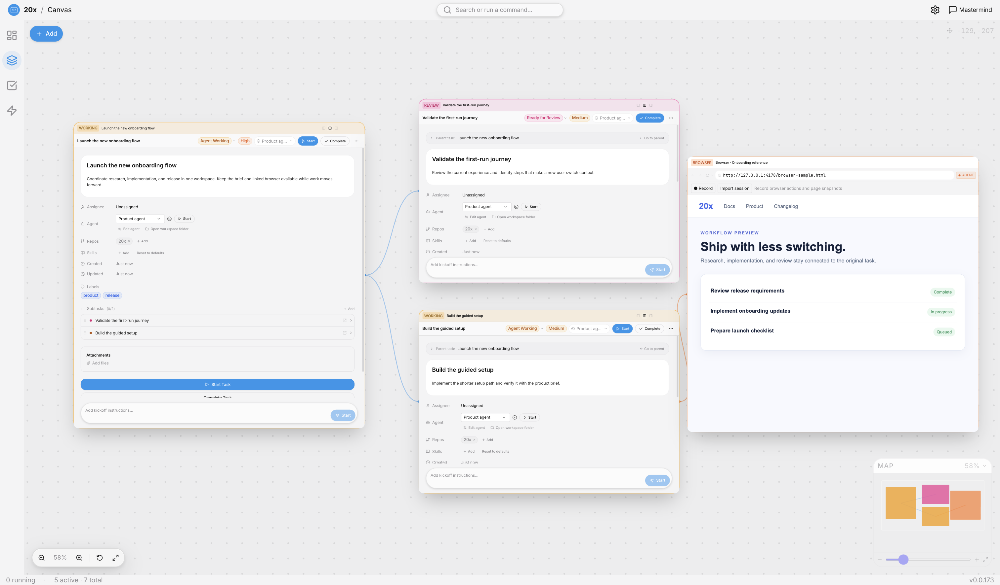
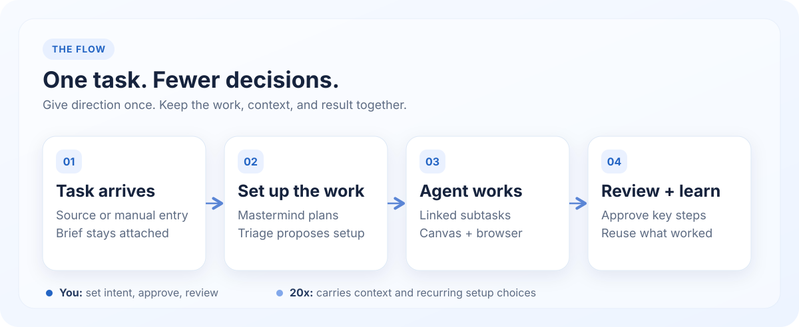
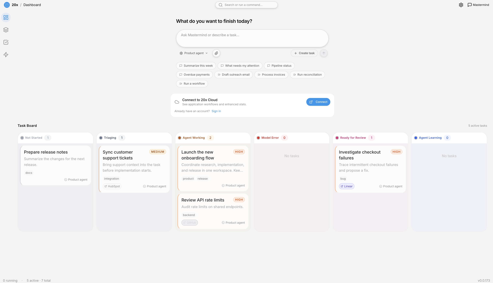
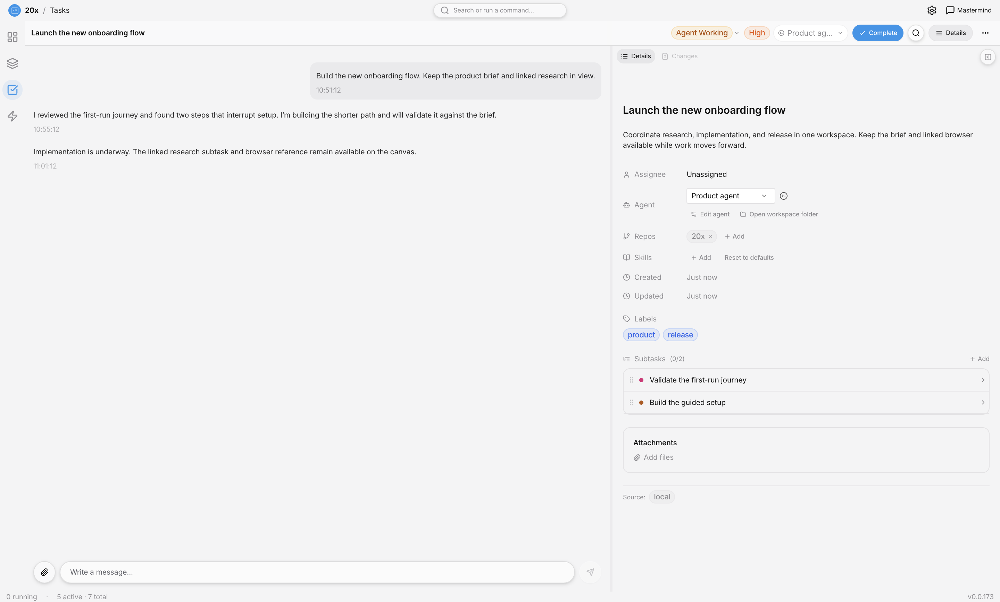
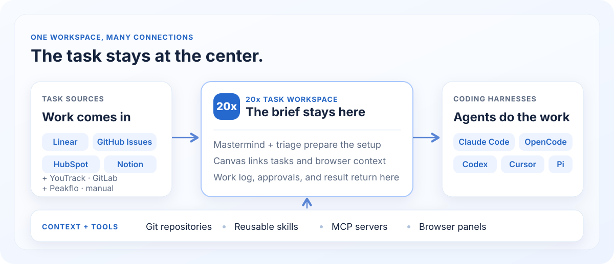
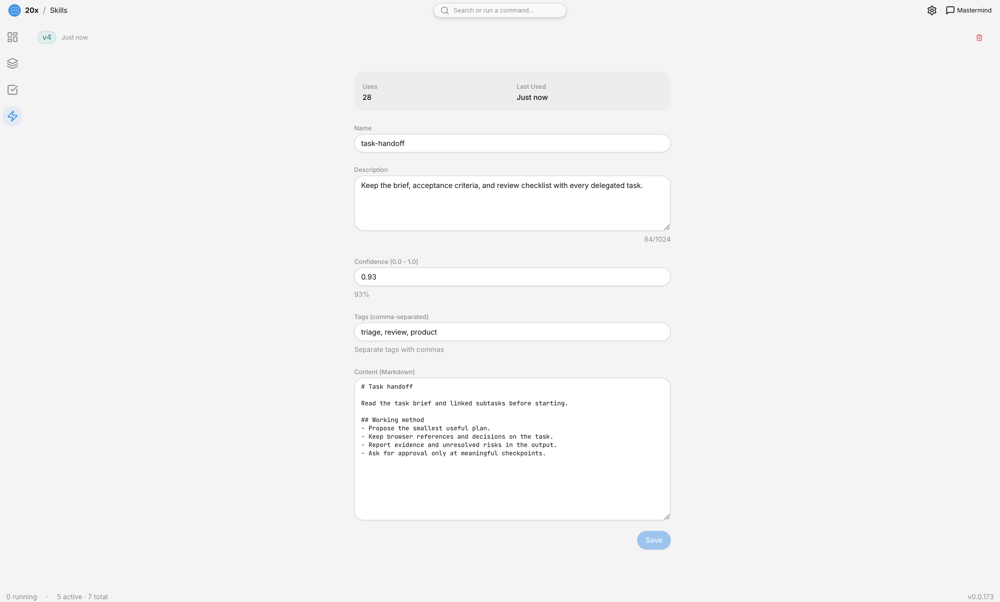
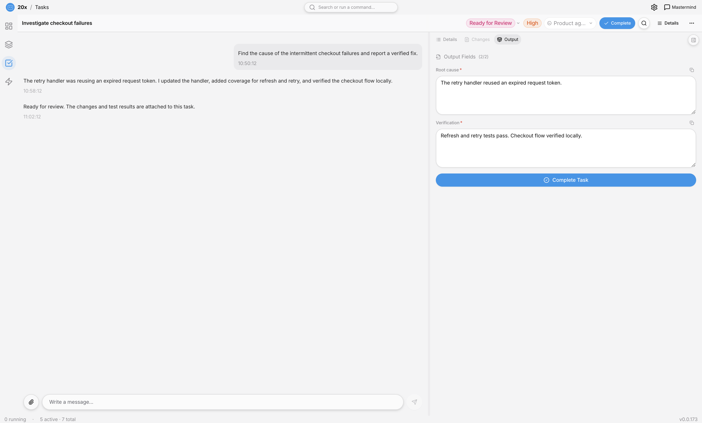

<p align="center">
  
</p>

# 20x

[](./LICENSE)
[](./package.json)
[](.)
[](https://discord.gg/fUVsqTWDxX)

**Give 20x the task. Keep your focus.**

20x is a desktop workspace organized around **tasks**, not agent chats. Connect a task source such as Linear, HubSpot, YouTrack, GitLab, Notion, or Peakflo, or create a task yourself. Mastermind and triage help decide how to run it; the brief, agent work, and result stay attached to the task.

> [!IMPORTANT]
> **The 20x metric: agent run hours ÷ your active hours in 20x.**
> The app measures your own multiplier from live agent work and time you spend on screen in 20x. It shows how much work you can delegate for the time you spend steering it. “20x” is the goal behind the name, not a guaranteed result.

**No cloud. No subscriptions. Everything runs on your machine.**

## Fewer small decisions. Less handholding.

Hand off the work once. Mastermind helps plan and coordinate subtasks. Triage proposes a priority, harness, skills, and repository. Canvas keeps related tasks and an embedded browser visible together. You step in for approvals and review the result on the task, without rebuilding context across chats and tabs.

<p align="center">
  
</p>

1. **Bring in the task.** Connect a task source or create a task in 20x. Its brief stays attached.
2. **Let 20x set up the work.** Ask Mastermind to break down the task; triage proposes the setup and the agent works from that context.
3. **Keep context together.** Open linked subtasks and a browser on the canvas while agents work.
4. **Review and learn.** Follow the work log and output, approve consequential steps, and turn useful feedback into reusable skills.

## Get more output from each handoff

20x helps you learn how to delegate better. Compare agent run hours with your own active time, review the work and result on each task, and give feedback. Reusable skills carry what worked into the next task, so you spend less time repeating instructions.

## How It Works

<p align="center">
  
</p>

**Your part:** Define the outcome, approve consequential actions when asked, then review the result and give feedback.

**20x's part:** Keep the task and context together; use Mastermind to plan subtasks and triage to propose priority, harness, skills, and repository; run and coordinate agents; keep the work log, output, and reusable learning attached to the task.

## Features

Light mode screenshots show the app with sample tasks, skills, and browser content.

### 🧭 Mastermind and triage

Start with the task instead of choosing an agent and writing a new prompt from scratch. Mastermind helps clarify the next step and coordinate subtasks. Triage proposes the priority, agent, skills, and repository; you can review that setup before work starts.

### 📊 Dashboard Workspace
- **Your 20x multiplier** — See live agent run hours relative to your active time in 20x
- **Overview dashboard** — See task completion, usage, and agent activity at a glance
- **Kanban task board** — Tasks grouped by status with drag-and-drop support
- **Workflow applications** — Launch and manage workflow apps directly from the dashboard
- **Presetup wizard** — Guided templates to get started quickly with new applications

<p align="center">
  
</p>

### 🤖 Built-in harnesses and ACP agents, one task workflow

20x includes **Claude Code, OpenCode, Codex, Cursor, and Pi**. You can also add compatible coding agents from the [ACP agent registry](https://github.com/agentclientprotocol/registry) or point 20x at a local ACP command in **Settings → Harnesses**. Each configured ACP agent becomes a harness choice for your tasks. Available agents depend on their distribution and your platform.

- **Claude Code** — Anthropic's coding harness
- **OpenCode** — Open-source coding harness
- **Codex** — OpenAI's coding harness
- **Cursor** — Coding harness through the Agent Client Protocol
- **Pi** — Open-source coding harness
- **ACP agents** — Add compatible agents from the registry or a local command
- **Live transcripts** — Watch agents think and work in real time with message counts
- **Human-in-the-loop** — Approve risky actions before execution
- **Task progress tracking** — Real-time progress events during agent execution

The task brief, repository, skills, and agent work log stay in the same view.

<p align="center">
  
</p>

### 🕸️ Canvas Workspace

Open a parent task and its subtasks as linked panels. Keep an embedded browser beside them so the agent can work with the same reference page you see. Canvas reduces the small decisions of which chat, tab, or task to open next: the brief, related work, and browser remain in view as you move between steps.

### 🔗 Smart Integrations

<p align="center">
  
</p>

- **Linear** — Pull issues, update status, post comments
- **HubSpot** — Sync tickets and workflows
- **YouTrack** — Connect JetBrains YouTrack projects and tasks
- **GitLab** — Full GitLab integration for task sourcing and repositories
- **Notion** — Sync Notion databases with full property and attachment support
- **Peakflo** — Connect your Peakflo Workflo tasks
- **GitHub Issues** — Pull issues directly from GitHub repositories
- **OAuth built-in** — Secure authentication flows

### 🧠 Skills System
- **Reusable instructions** — Create skill templates for common patterns
- **Learn from outcomes** — Review agent results and feed useful lessons into reusable skills
- **Auto-learning** — Agents can update skills based on feedback
- **Confidence tracking** — Skills improve over time
- **2-way sync** — Skills synchronize bidirectionally between 20x and Workflo
- **Searchable skills** — Quickly find skills with built-in search

<p align="center">
  
</p>

### 🛠 Developer-First
- **Git worktree management** — Isolated branches per task
- **Repository context** — Agents know which repos to work on (GitHub & GitLab)
- **MCP servers** — Connect Model Context Protocol tools with auto-registration
- **Browser MCP tools** — Expose console logs and network activity from browser panels to agents
- **Idle workspace cleanup** — Prunes `node_modules` in workspaces idle for 7+ days to reclaim disk
- **Local-first** — SQLite database, no cloud required

### 📋 Task Management
- **Subtasks** — Break tasks into subtasks with ordering and drag-and-drop reordering
- **Recurring tasks** — Daily, weekly, monthly schedules
- **Task snoozing** — Snooze tasks and have them resurface at the right time
- **Rich metadata** — Types, priorities, due dates, labels
- **File attachments** — Add context files to tasks
- **Output fields** — Structured task results
- **Smart search** — Find anything fast

<p align="center">
  
</p>

### 🎙 Voice (desktop, optional)
- **Local speech to text** — Runs on your machine; no audio is stored or sent anywhere
- **Talk to Mastermind** — Microphone in the top bar, or `Cmd/Ctrl+Shift+Space`, from any view
- **Dictate anywhere** — A microphone in every agent message box and the dashboard command box
- **Keep talking** — Each pause sends a sentence and the microphone stays open
- **Spoken answers** — 20x reads an agent answer aloud, and stops the moment you speak. It uses the voice your system already has, so it needs no download; a more natural downloaded voice is one click away
- Off by default: install the runtime and a model in **Settings → Voice**. See [docs/voice.md](docs/voice.md) and [docs/voice-tts.md](docs/voice-tts.md)

### 💓 Heartbeat Monitoring
- **Enterprise heartbeat** — Continuous health checks with GitHub preflight
- **CI failure detection** — Automatically detect CI pipeline failures
- **State syncing** — Keep task state in sync across sessions

## Getting Started

### Supported Platforms

- **macOS** — Full support
- **Windows** — Full support
- **Linux** — AppImage installer

### Prerequisites

- **Node.js** >= 22
- **pnpm** >= 9
- **Git** (for worktree features)
- **GitHub CLI** (optional, for GitHub repo features)
- **GitLab CLI** (optional, for GitLab repo features)

### Installation

```bash
# Clone the repository
git clone https://github.com/peakflo/20x.git
cd 20x

# Install dependencies
pnpm install
```

### macOS: Signed & Notarized Releases

Release artifacts are signed with an Apple Developer ID certificate and notarized to avoid Gatekeeper install/open warnings.

For maintainers, setup details are in [docs/macos-signing-notarization.md](./docs/macos-signing-notarization.md).

### Configuration

**API Keys:**
Configure in Agent Settings:
- Anthropic API key for Claude Code
- OpenAI API key for OpenCode (if needed)

**Database:**
- Stored at `~/Library/Application Support/pf-desktop/pf-desktop.db` (macOS)
- Automatic backups before migrations

**Integrations:**
1. Get OAuth credentials from Linear/HubSpot/Peakflo
2. Configure in Integrations settings
3. Complete OAuth flow in-app

### Development

```bash
# Start dev server
pnpm run dev

# Run tests
pnpm test

# Build for distribution
pnpm run build:mac    # macOS
pnpm run build:win    # Windows
pnpm run build:linux  # Linux
```

## Architecture

### Data Flow

```
React UI → Zustand Store → IPC Client → Preload Bridge → Main Process → SQLite
```

- **Renderer** — React 19 + Tailwind CSS 4 + Zustand 5
- **Main Process** — Electron 34 + SQLite + Agent orchestration
- **Security** — Full context isolation, no Node.js in renderer

### Agent Architecture

**Session Lifecycle:**
1. **Start** — Agent assigned, skills applied, session created
2. **Streaming** — Real-time output sent to UI
3. **Approval** — Agent pauses for human decisions
4. **Completion** — Results saved, task updated

See [AGENTS.md](./AGENTS.md) for detailed architecture.

## Tech Stack

| Layer | Technology |
|-------|-----------|
| Shell | Electron 44 |
| Build | electron-vite |
| Frontend | React 19 + Tailwind CSS 4 + Zustand 5 |
| UI Components | Radix UI primitives |
| Styling | cva + Tailwind CSS tokens |
| Icons | Lucide React |
| Font | Geist |
| Database | SQLite (better-sqlite3, WAL mode) |
| Agent backends | OpenCode SDK, Claude Agent SDK, Codex app server, Cursor ACP, Pi, configurable ACP agents |
| Testing | Vitest + happy-dom |

## Contributing

We welcome contributions! Here's how:

1. **Fork** the repo
2. **Create a branch**: `git checkout -b feature/my-feature`
3. **Write code**: Follow TypeScript strict mode, ESLint, Prettier
4. **Add tests**: Vitest tests for new features
5. **Commit**: Use conventional commits (`feat:`, `fix:`, etc.)
6. **Push**: `git push origin feature/my-feature`
7. **Open PR**: Describe changes, ensure CI passes

### Code Style
- TypeScript strict mode
- Minimal Tailwind classes (prefer CSS variables)
- Use `pnpm` (not npm)
- Check `MEMORY.md` for project patterns

## Community

- **Issues**: [GitHub Issues](https://github.com/peakflo/20x/issues)
- **Discord**: https://discord.gg/fUVsqTWDxX

## Security

### Local-First
- All data stored locally in SQLite
- No cloud sync, no subscriptions
- Optional database encryption

### OAuth & API Keys
- Tokens encrypted with Electron `safeStorage`
- Keys never exposed to renderer process
- Parameterized SQL queries only

### Electron Security
- `contextIsolation: true`
- `nodeIntegration: false`
- External links open in system browser

## Roadmap

### Planned
- Additional integrations (Jira, Asana)
- Team collaboration (shared task sources)
- Cost tracking (token usage per session)
- Agent templates (pre-configured profiles)
- Plugin marketplace (community skills)

### Recently Shipped
- ✅ Light theme
- ✅ Cursor coding agent support (Agent Client Protocol)
- ✅ Idle workspace cleanup — node_modules pruning after 7 days
- ✅ Browser console logs and network activity exposed via MCP
- ✅ Dashboard workspace with Kanban board and workflow apps
- ✅ Subtask support with ordering and drag-and-drop
- ✅ GitLab integration (task sourcing & repositories)
- ✅ YouTrack integration
- ✅ Notion integration with full property support
- ✅ GitHub Issues integration
- ✅ Windows and Linux platform support
- ✅ Task snoozing
- ✅ Skills 2-way sync with Workflo
- ✅ Heartbeat monitoring with CI failure detection
- ✅ Presetup wizard and dashboard templates
- ✅ Claude Sonnet 4.6 and GPT-6 Astra model family support
- ✅ Multi-agent support (OpenCode, Claude Code, Codex, Pi)
- ✅ Skills system with auto-learning
- ✅ Recurring tasks
- ✅ Linear, HubSpot, Peakflo integrations
- ✅ MCP server management
- ✅ Git worktree management

## License

[MIT](./LICENSE) © 2026 Peakflo

---

Built with [Electron](https://electronjs.org), [React](https://react.dev), and [Anthropic Claude](https://anthropic.com).
