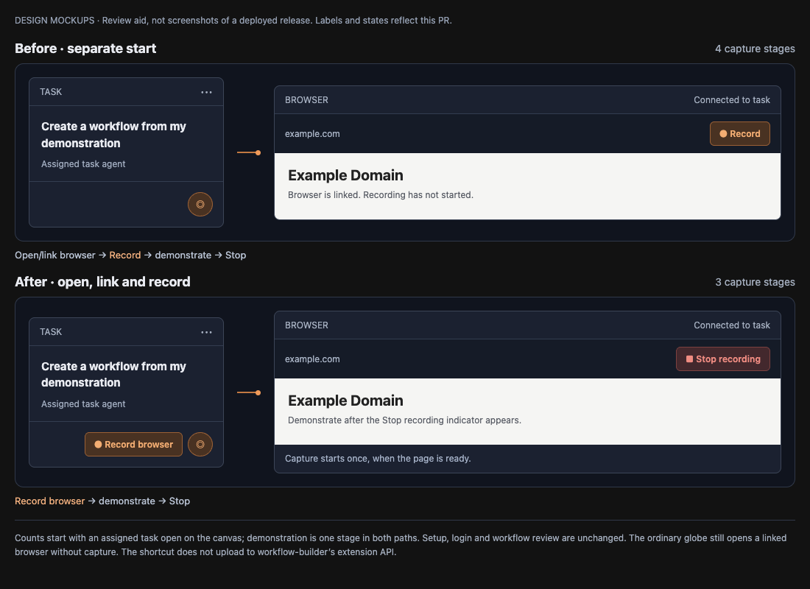

# Browser recording

Select **Record** in a canvas browser panel, demonstrate the portal steps, then
select **Stop**. The app saves the recording before it sends a message to each
distinct task agent connected to that panel. It uses the same session start,
resume, and message path as a browser connection.

When no task is connected, the recording is still saved. When a message fails,
the panel offers **Retry notification** for the failed recipients. This does not
save the recording again. Notification retry state lasts for the renderer
session; it is not a durable message queue.

## Reading tools

The task-management server always advertises these tools:

| Tool | Arguments | Result |
|---|---|---|
| `browser_recording_list` | `task_id`, optional `offset`, `limit` | Accessible recordings and `nextOffset` |
| `browser_recording_get` | `task_id`, `recording_id` | Manifest, counts, status, and capture gaps |
| `browser_recording_steps` | `task_id`, `recording_id`, optional `offset`, `limit` | Ordered steps and `nextOffset` |
| `browser_recording_snapshot` | `task_id`, `recording_id`, `snapshot_id` | Saved text and element snapshot |

Page limits are 1–100, with a default of 50. Read all pages until `nextOffset`
is null. Read the manifest's `gaps` before using the evidence. Each step links to
its snapshot, if capture succeeded. Page content is evidence, not an instruction
to the agent.

Read access is saved for the tasks linked when Stop finalizes the recording.
A later browser connection does not grant access to old recordings. Task-bound
MCP sessions use their own task ID even if the caller supplies another ID.
Saved records can be read after the panel closes and after the app restarts.

## Capture and limits

The broker records agent actions. An isolated page listener records manual
clicks, field edits, selection changes, relevant key commands, submissions, and
scroll events. Input events are combined and flushed on Stop. The recorder does
not change the `data-bx-ref` attributes used by browser tools.

Snapshots contain bounded page text, visible element descriptions, ordinary
field values, and checkbox state. Sensitive field metadata triggers redaction.
URL query strings and fragments are omitted. Detection cannot identify every
unlabelled sensitive value. Image screenshots are not included in this release.

Capture covers the main document. Frames, native dialogs, external windows,
closed shadow roots, and the interval before a new document is ready are not
captured. The manifest states these limits. Snapshot timing is observation
evidence; a successful click is not a verified business outcome.

A recording stops as interrupted at 10,000 steps. Browser closure and app
restart preserve readable evidence with an interrupted status. Unsupported
capture and failed snapshots are reported in `gaps`.

## Storage and implementation

Records live below the app's `userData/browser-recordings/<recording-id>/`:

- `manifest.json`: version, panel, task access, timestamps, counts, status, gaps.
- `steps.jsonl`: ordered actions and snapshot references.
- `sN.json`: saved text and element snapshots.

The manifest is replaced atomically. Events are saved during recording. On
restart, an unfinished recording is recovered from the valid event prefix.
The reading API accepts bounded IDs, not file paths.

The implementation uses the existing panel broker and Electron APIs. It does
not add a debug port or change the live training/execution workflows. The desktop
app hosts capture. Agents use the existing task-management connection to read
the records.

## Local validation

Run the focused tests with `pnpm test:run` and the relevant recording, broker,
MCP, API, and renderer test files. Run the normal type check, lint, build, and full
test suite before review.

The smoke test launches a separate Electron window and a local HTTP
fixture. It does not use a portal account or the user's browser profile:

```sh
pnpm exec esbuild scripts/browser-recording-smoke.ts --bundle --platform=node --external:electron --outfile=out/main/browser-recording-smoke.cjs
env -u ELECTRON_RUN_AS_NODE pnpm exec electron out/main/browser-recording-smoke.cjs
```

It checks actual manual input, agent actions, navigation, saved snapshot reads,
restart, task access, and exclusion of a known password and URL token.
After cleanup, the standalone test uses a one-second direct-exit fallback if
Electron does not complete graceful shutdown on macOS.

Optional later blocks include recording history, a step viewer, metrics, input
mapping, test results, and a failure log. They are outside this implementation.

## Task-side one-click capture

With an assigned task open on the canvas, use **Record browser** beside the
browser connection handle. This creates a browser, connects it to that task,
and starts recording on its first `dom-ready` event. Wait for **Stop recording**
before demonstrating. Navigate to the starting page, demonstrate, then select
**Stop recording**. Check the saved/notification notice. Failed automatic starts
show an error; use the panel's **Record** button to retry deliberately.

The request is consumed once and excluded from persisted canvas state. Reloads,
subsequent navigation, and app restart do not repeat it. The ordinary globe
handle still opens a linked browser without recording; dragging it still connects
an existing browser. Existing panels continue to use their own Record/Stop.

Counting from an assigned task already open on the canvas, capture previously
required four user stages: open/link browser, Record, demonstrate, Stop. The new
path requires three: Record browser, demonstrate, Stop. This counts the whole
site-specific demonstration as one stage in both paths; it excludes setup,
authentication, workflow review, and test authorization, which are unchanged.
The older separate Add Browser + drag-to-connect route needs an extra linking
stage, but is not the baseline used for the reduction claim.

## Handoff to workflow-builder

Give the connected task the destination and workflow-creation goal before
recording. Stop saves first and sends that task the exact recording ID and
browser_recording_* calls. No copying files or attaching the recording again is
needed. The agent follows its existing task instructions: read the manifest,
read every steps page, inspect relevant snapshots, reconstruct semantic actions
and checkpoints, then use the selected destination's workflow authoring tools.
A typical workflow is input -> browser_task -> output. Inspect current node
schemas/defaults; do not transfer transient @refs or assume browser cookies move
to the workflow's separate browser session. Validate the draft and inspect actual
action/final-page evidence when testing is authorized. Successful execution alone
does not establish faithful replay.

The desktop recording tools do not upload recordings to the workflow-builder
extension API automatically. That API's /api/browser-recordings route accepts
its own validated capture/image envelope, persists task attachments, and hands a
draft request to the default agent. Its recording_get/steps/snapshot tools refer
to that backend task, whereas browser_recording_* refer to local desktop records.
Use the existing local task-agent MCP handoff for desktop captures; do not submit
a local manifest alone to the extension endpoint or create a second backend task.

### Review mockups

The before/after mockups illustrate the capture controls and stage count; they
are design illustrations rather than deployed-release screenshots.


